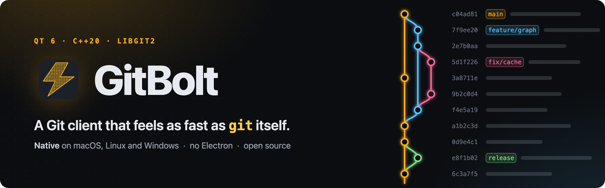
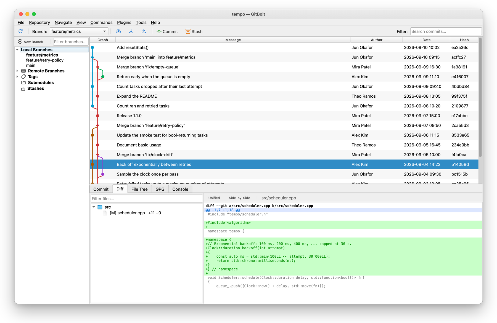
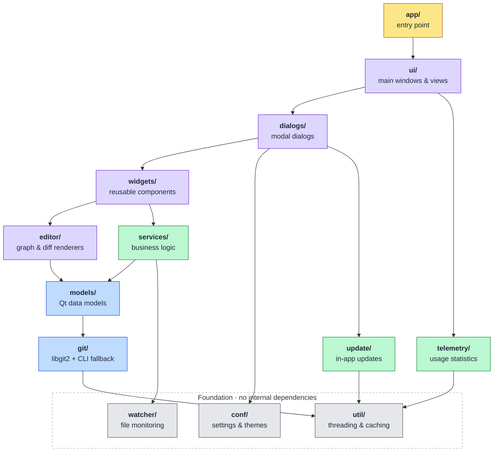

<p align="center">
  <a href="https://www.gitbolt.com">
    
  </a>
</p>

<p align="center">
  <a href="https://github.com/Inverian/GitBolt/actions/workflows/ci.yml"></a>
  <a href="https://github.com/Inverian/GitBolt/releases"></a>
  <a href="LICENSE"></a>
  <a href="#download"></a>
  <a href="https://www.gitbolt.com"></a>
  <br>
  <a href="https://www.qt.io"></a>
  <a href="docs/BUILDING.md"></a>
  <a href="https://libgit2.org"></a>
  <a href="https://github.com/Inverian/GitBolt/commits/main"></a>
</p>

<p align="center">
  <strong>Fast, cross-platform Git GUI client built with Qt 6, C++, and libgit2.</strong>
</p>

<p align="center">
  <a href="https://www.gitbolt.com"><b>Website</b></a> &nbsp;·&nbsp;
  <a href="#download"><b>Download</b></a> &nbsp;·&nbsp;
  <a href="docs/BUILDING.md"><b>Build from source</b></a> &nbsp;·&nbsp;
  <a href="CHANGELOG.md"><b>Changelog</b></a> &nbsp;·&nbsp;
  <a href="CONTRIBUTING.md"><b>Contributing</b></a>
</p>

<p align="center">
  
</p>

GitBolt is a high-performance, feature-complete Git client for macOS, Linux, and Windows. Built natively in C++ with Qt 6 for maximum rendering performance and minimal resource usage.

---

## Why GitBolt?

Most desktop Git GUIs today are either Electron-based (dragging a full JavaScript runtime along for the ride) or expensive commercial native apps — and Linux options are especially thin. GitBolt fills the gap with a single codebase that delivers:

- **Native performance** — Qt 6 with libgit2, no Electron, no JavaScript runtime
- **Power user features** — Interactive rebase, blame drill-down, three-way merge, Git Flow
- **Lightweight** — Compiled binary, hardware-accelerated rendering
- **Cross-platform** — Identical experience on macOS, Linux, and Windows
- **Scriptable** — env-gated test/automation bridge drives the full UI
  from scripts and AI agents (see docs/AGENT_TESTING.md)

---

## Download

Installers for every release are on the
[Releases page](https://github.com/Inverian/GitBolt/releases), newest first.

| Platform | Download | Requirements |
|---|---|---|
| macOS | `GitBolt-<version>-Darwin-arm64.dmg` | Apple Silicon, macOS 13 (Ventura) or later |
| Windows | `GitBolt-<version>-Windows-AMD64.exe` | Windows 11, 64-bit (x64) |
| Ubuntu | `gitbolt_<version>_amd64.deb` | Ubuntu 24.04 or later, x86-64 |

These are the platforms GitBolt supports. GitBolt also installs and
updates on Windows 10 (version 1809 or later), but Windows 10 isn't
supported. On a Windows PC with an Arm processor, GitBolt runs under
Windows' x64 emulation; that works, but isn't supported. The .deb also
installs on Debian 13 and on distributions based on Ubuntu 24.04 or
Debian 13, such as Linux Mint 22, but they aren't supported either.
From 1.0.0 on there is no AppImage: see [Install](#install) to switch
to the .deb.

Each release also lists the files' SHA-256 checksums in `SHA256SUMS.txt`,
and from 1.0.0 on has a `-symbols.zip` for each platform: debug symbols
the maintainers use to read crash reports. You don't need them to
install or run GitBolt (the `GitBolt.exe` in the Windows one is not an
installer).

GitBolt runs your git for clones, fetches, pushes and commits: git 2.25
or later ([git-scm.com/downloads](https://git-scm.com/downloads)). It
runs the first git on your PATH (on macOS and Linux, the PATH your
login shell sets up), so restart GitBolt after you install git.
GitBolt warns you when that git has known security flaws.

### Install

- **macOS**: open the .dmg and drag GitBolt to Applications, then open
  it from there. A GitBolt that runs from the disk image can't update
  itself.
- **Windows**: run the installer (see [First launch](#first-launch) for
  the prompts). It asks for administrator permission, installs GitBolt
  (by default in Program Files), and adds it to the Start menu, and
  **Open in GitBolt** to Explorer's right-click menu on folders (on
  Windows 11, under **Show more options**).
- **Ubuntu**: in the folder you downloaded it to, run
  `sudo apt install ./gitbolt_<version>_amd64.deb` (the `./` matters).
  apt also installs python3-nautilus, for **Open in GitBolt** in
  Nautilus: restart Nautilus once (`nautilus -q`) to see it.

**From the AppImage** (GitBolt 0.9.x): install the .deb as above, then
delete the AppImage. Your settings carry over: both keep them in
`~/.config/GitBolt`. The AppImage keeps working, but gets no more
updates. On a distribution the .deb doesn't install on, such as Fedora,
build GitBolt from source ([Linux notes](docs/BUILDING.md#linux-notes));
such builds don't update themselves.

### First launch

The Windows installer isn't signed yet, and the Mac app isn't notarized
by Apple, so the first time you open a download (the Windows installer,
or GitBolt on a Mac), your system asks you to confirm it.

- **macOS**: the app is signed with GitBolt's own certificate, which
  macOS doesn't know, and isn't notarized by Apple. When you first open
  it, macOS says it can't verify GitBolt and doesn't open it. Close
  that message, open **System Settings › Privacy & Security**, scroll
  down to **Security**, and click **Open Anyway** next to the message
  about GitBolt. The button shows for about an hour after you tried to
  open GitBolt. Confirm with **Open Anyway** and your login password.
  When you open a repository in Documents, Desktop or Downloads, macOS
  asks whether GitBolt may access that folder. After the update from
  0.9.12 to 1.0.0 it may ask once more; from 1.0.0 on, updates keep
  that access.
- **Windows**: if SmartScreen says "Windows protected your PC", click
  **More info**, then **Run anyway**. The administrator prompt says the
  publisher is unknown: click **Yes**. While **Smart App Control** is on
  (Windows 11), it may block GitBolt's installer or GitBolt, and it
  can't make an exception for one app. If it does, then until GitBolt's
  installers are signed, GitBolt runs only while Smart App Control is
  off or still in evaluation mode (**Windows Security › App & browser
  control › Smart App Control settings**).
- **Ubuntu**: nothing more to do.

Before your first commit, enter your name and email in **Tools ›
Settings › Git Config**, unless git already has them; the Commit
dialog's **Set name and email…** opens that page. GitBolt saves them as git's
`user.name` and `user.email`, which every commit records.

### Updating

GitBolt checks for a new release once a day, and a bar says when one
is out. **Help › Check for updates** (on macOS also **GitBolt › Check
for Updates…**) checks at once. The update window shows what's new;
**Install and Restart** downloads the new version, checks it against
the release's checksums, installs it and starts GitBolt again with the
repository you had open. A bar at the top then says which version
GitBolt was updated to; **What's New** opens the release page.

- **macOS** replaces GitBolt.app where it is, so it can't update a
  GitBolt that runs from the disk image, or from a folder you can't
  change.
- **Windows** asks for administrator permission. The prompt names
  Windows PowerShell (verified publisher: Microsoft Windows), which
  runs GitBolt's installer; **Show more details** shows its long
  encoded command. If no prompt comes up, click the flashing shield
  button on the taskbar. A prompt that comes up and is left unanswered
  for about 2 minutes is cancelled, and nothing is installed (**Try
  Again** asks again).
  After **Yes**, GitBolt closes while the installer runs, usually for a
  few seconds, and starts again by itself. If you start it in the
  meantime, it says the update is still going in and closes again. If
  GitBolt is also open in another window, or in another user's
  session, **Install and Restart** first asks you to close it.
- **Ubuntu** first asks apt whether the new .deb can be installed, then
  asks for your password. Without pkexec, GitBolt shows the `apt`
  command to run instead.

To stop the daily check, clear **Check for updates automatically** in
**Tools › Settings › Updates**. Builds from source don't update
themselves. [PRIVACY.md](PRIVACY.md#update-checks) says what a check
sends.

### Uninstalling

- **macOS**: quit GitBolt and move it from Applications to the Trash.
- **Windows**: quit GitBolt. Then in **Settings › Apps › Installed
  apps**, click **⋯** next to GitBolt, then **Uninstall**, and
  **Uninstall** again. Windows asks for administrator permission (the
  publisher is unknown): click **Yes**, then **Uninstall** and **Close**
  in GitBolt's uninstaller.
- **Ubuntu**: `sudo apt remove gitbolt`.

This doesn't touch your repositories. It leaves GitBolt's settings,
crash report, log and update downloads behind; to remove them too,
delete these:

- **macOS**: `~/.config/GitBolt` (settings), `~/.gitbolt` (crash
  report), `~/Library/Logs/GitBolt` (log), `~/Library/Caches/GitBolt`
  (update downloads), and the file
  `~/Library/Preferences/com.gitbolt.app.plist` (macOS's own record of
  GitBolt's file dialogs).
- **Windows**: `%APPDATA%\GitBolt` (settings), `%USERPROFILE%\.gitbolt`
  (crash report) and `%LOCALAPPDATA%\GitBolt` (log and update
  downloads).
- **Ubuntu**: `~/.config/GitBolt` (settings), `~/.gitbolt` (crash
  report), `~/.local/state/GitBolt` (log) and `~/.cache/GitBolt`
  (update downloads).

The name and email you set in GitBolt's Git Config settings are git's
own settings, usually in `~/.gitconfig` (on Windows
`%USERPROFILE%\.gitconfig`), and stay.

---

## Features

### Core Git Operations
- Visual revision graph with lane-based topology rendering
- Side-by-side and unified diff viewer with syntax highlighting
- File-level staging with per-file and stage-all/unstage-all flows
- Interactive rebase with drag-and-drop reordering and
  continue / skip / abort controls for conflicted rebases
- Revert a commit (Commands › Revert commit..., or right-click it in
  the history): the changes that undo it are staged with git's message
  for you to commit, and for a merge commit you pick the parent to
  revert against
- Cherry-pick a commit, from Commands or the history's right-click
  menu, with a preview of its details; a `git cherry-pick` of several
  commits started in a terminal can be continued, skipped or aborted
  from the operation bar
- Stash save/apply/pop/drop with diff preview
- Branch management (create, delete, rename, checkout, merge,
  push, set-upstream — from the sidebar context menu or Commands)
- Clone, push, pull, fetch with credential helper integration

### Repository Inspection
- Commit log with paged loading (handles 100K+ commits smoothly)
- File history with rename tracking (File Tree → Show History,
  jump the revision graph to any revision that touched the file)
- Reflog viewer with checkout and reset (soft / mixed / hard)
  recovery actions on any entry
- Search by message, author, date range, file content (pickaxe), or file path

### Repository Management
- Tag management (annotated and lightweight)
- Submodule operations (init, update, sync, deinit)
- Worktree creation (new working trees on any branch)
- Git Flow workflow integration
- Repository maintenance (gc, prune, fsck, repack) with disk stats
- Multi-repository session support

### User Experience
- Non-blocking repository open — the repo view appears instantly with
  a loading spinner while commits, branches, and status stream in from
  worker threads (no UI freeze even on huge working trees)
- Built-in terminal (Console tab, Tools → Git bash) opened in the
  repository: your login shell under a PTY on macOS and Linux, cmd.exe
  under ConPTY on Windows. Plain text for now, no colors or full-screen
  programs
- Light, Dark, and System theme modes
- Customizable code font and tab size
- Configurable keyboard shortcuts
- Recent repositories with drag-and-drop, max-count + alphabetical-sort
  + path-shortening preferences
- Configurable default window size (with min-size enforcement) and a
  single global default size for every popup dialog; both with optional
  "restore previous" persistence per launch
- Per-dialog geometry persistence so each popup remembers its last
  drag-resized shape independently
- "Contained in branches" lookup on every commit detail (resolves via
  `git branch --all --contains` so it covers both local and remote
  tracking branches)
- File-status legend tooltip in the Commit dialog headers (hover the
  ⓘ icon to see what M / A / D / R / U / ? mean)
- Built-in background tools:
  - Periodic background fetch (Plugins › Periodic background fetch),
    at an interval you choose
  - Repository statistics summary

### Platform Integration
- macOS Finder "Open in GitBolt" on a folder's right-click menu (in its Services submenu when there are several), a macOS service that comes with GitBolt.app and works once GitBolt has been opened once. If it doesn't show, turn it on in System Settings › Keyboard › Keyboard Shortcuts… › Services › Files and Folders. Folders dropped on GitBolt's Dock icon, and `open -a GitBolt <folder>`, open too
- Windows Explorer "Open in GitBolt" context menu, on folders and folder backgrounds (on Windows 11, under Show more options)
- Linux Nautilus extension and `.desktop` file
- A folder inside a repository opens that repository; a folder in none says so
- Cross-platform installers (DMG, NSIS, DEB)

---

## Architecture

GitBolt uses a **13-module architecture** following Qt convention with strict single-responsibility:

```
src/
├── git/        Core git operations (libgit2 wrappers + CLI fallback)
├── conf/       Settings persistence and theme management
├── watcher/    File system monitoring
├── util/       Threading, caching, performance, crash handling
├── telemetry/  Usage statistics and crash reports (see PRIVACY.md)
├── update/     In-app updates (official builds only)
├── models/     Qt data models (QAbstractItemModel subclasses)
├── services/   Business logic orchestration (GitService, RepoManager)
├── editor/     Custom renderers (revision graph delegate, syntax highlighter)
├── widgets/    Reusable UI components (graph, diff, staging, blame, etc.)
├── ui/         Main windows and views (MainWindow, RepositoryView, Dashboard)
├── dialogs/    Modal dialogs (clone, settings, rebase, merge, etc.)
└── app/        Application entry point and platform-specific integrations
```

### Module Dependency Graph



An arrow means *depends on*; edges already implied by a longer path are left out.
Colours mark the layers: foundation, git core, business logic, presentation, entry point.

Each module is a separate CMake `STATIC` library, enforcing clean dependency boundaries and enabling fast incremental builds.

### Key Design Decisions

| Decision | Rationale |
|----------|-----------|
| **Qt 6 + C++20** | Maximum native performance, mature widget system, hardware-accelerated rendering |
| **libgit2 primary, git CLI fallback** | libgit2 for local repository access, including the hot path (log, diff, blame, status); the CLI for network operations (clone, fetch, pull, push, with git's own SSH and credential setup), commits (so the repository's hooks and commit signing apply), interactive rebase, git-flow |
| **Headers and sources together** | Qt convention; matches Gittyup, KeePassXC, FreeCAD |
| **PascalCase filenames** | Qt convention (`QMainWindow.h` style) |
| **Background threading via QtConcurrent** | Network operations, commits, merges, rebase steps and other long git commands run on worker threads, with QFutureWatcher signals back to the UI; some local changes (staging, stashing, switching branches, creating or deleting branches and tags) still run on the UI thread |
| **Paged commit log model** | `fetchMore()` with 256-row pages and incremental lane computation |
| **Lane-based revision graph** | Greedy lane assignment with bezier merge curves, custom QStyledItemDelegate |

---

## Building from Source

For full step-by-step instructions on installing dependencies and building GitBolt on **macOS**, **Windows**, and **Linux**, see **[docs/BUILDING.md](docs/BUILDING.md)**.

The short version, once your environment is set up:

```bash
git clone https://github.com/Inverian/GitBolt.git
cd GitBolt
cmake -B build -DCMAKE_BUILD_TYPE=Release -G Ninja
cmake --build build --parallel
```

Required tools at a glance:

| Dependency | Minimum version |
|---|---|
| C++ compiler | C++20 (Apple Clang 14+, GCC 11+, MSVC 19.30+) |
| CMake | 3.21 |
| Qt | 6.5 (6.9.2 on macOS) |
| libgit2 | none: the pinned 1.9.7 is built in, with GitBolt's patches (`-DGITBOLT_BUNDLED_LIBGIT2=OFF`: a system 1.9.5 or later, without them) |

On macOS with a current Xcode SDK, Qt before 6.9.2 fails to link: its CMake
package still requests the AGL framework, which the SDK no longer ships.
CI builds with Qt 6.11 on all three platforms, and on all three it builds
the pinned libgit2 from source, with GitBolt's patches, and links it
statically, as a build from source does by default, so no installer
depends on a libgit2 package. The first configure of a build directory
downloads it. libgit2 only accesses local repositories:
network operations run the `git` CLI, with git's own SSH and credential
configuration. The macOS app runs on macOS 13 (Ventura) or later, the
oldest release Qt 6.11 supports.

See [docs/BUILDING.md](docs/BUILDING.md) for how to install each of these on your platform, configure CMake, run the tests, build installers, and troubleshoot common issues.

---

## Privacy and usage statistics

Official GitBolt builds (releases, and CI's builds of `main`) send
usage statistics to the GitBolt maintainers' own servers: which
commands are used and how fast repositories open, under a random
install ID, and summaries of crashes and errors, which carry no
install ID. Never repository names, paths, branches, commit messages
or file contents. It is on by default; turn it off in **Tools ›
Settings › Usage Statistics**, or with `GITBOLT_TELEMETRY=0`. A build
without that page, such as a build from source or a fork, sends
nothing.

[PRIVACY.md](PRIVACY.md) lists exactly what is sent, how long it is
kept, and how to have it deleted.

## Security

To report a security vulnerability, please don't open a public issue:
see [SECURITY.md](SECURITY.md) for how to report it privately.

---

## License

GitBolt is licensed under the **GNU General Public License v3.0** (GPL-3.0).

This means you are free to:

- **Use** GitBolt for any purpose, including commercial use
- **Study** the source code and learn from it
- **Modify** the source code to suit your needs
- **Distribute** your modifications, provided they are also licensed under the GPL-3.0
- **Contribute back** to the official GitBolt project

In exchange, the GPL requires that:

- Modified versions you distribute must remain under the GPL-3.0
- You must make the source code available with any binary distribution
- You must preserve copyright notices and license information
- You cannot impose additional restrictions on the recipients of your distribution

See [LICENSE](LICENSE) for the full GPL-3.0 text.

### Trademark

The name **"GitBolt"** and the GitBolt logo are **trademarks** of the GitBolt project, protected separately from the source code license. The GPL grants you rights to the source code, but not to the name or logo.

If you fork GitBolt under the GPL, you are required to **rebrand** your fork — choose a different name and use a different logo. This is the same approach used by Firefox, Visual Studio Code, Chromium, and Krita, and protects users from confusion about what is the official GitBolt project.

See [TRADEMARK.md](TRADEMARK.md) for the full trademark policy.

### Contributing

Contributions are welcome! See [CONTRIBUTING.md](CONTRIBUTING.md) for guidelines on reporting bugs, suggesting features, and submitting pull requests.

---

<p align="center">
  <sub>
    <a href="https://www.gitbolt.com">gitbolt.com</a> &nbsp;·&nbsp;
    Licensed under the <a href="LICENSE">GPL-3.0</a> &nbsp;·&nbsp;
    “GitBolt” and its logo are <a href="TRADEMARK.md">trademarks</a>
  </sub>
</p>
